<div align="center">

# RONAQ

**Apki ronaq, ek jagah.** A marketplace and event planner for the people who make Pakistani celebrations happen.

**[▶ Live demo](https://ronaq-mu.vercel.app)** · [Features](#features) · [Tech](#tech-stack) · [Architecture](#architecture) · [Run locally](#run-it-locally)

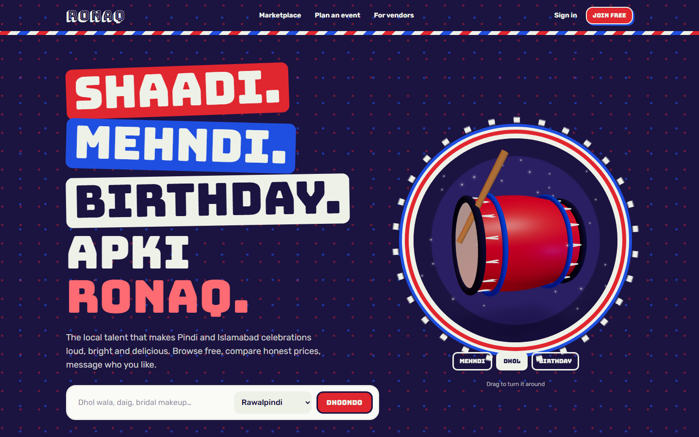

</div>

---

Event vendors in Pakistan are found through WhatsApp groups, Instagram and word of mouth: henna artists, home caterers, daig houses, decorators, dhol players. Ronaq gives them a proper storefront, and gives families a planner that turns "we have a shaadi in 50 days" into a checklist, a budget and a shortlist of vendors to message.

I built this from a 15-page product requirements document, designing and building three products on one codebase: the family-facing site, a vendor dashboard and an operations console.

> **Try it:** sign in as `ayesha@example.com` / `password123` (a family planning a wedding) or `hina@example.com` / `password123` (a henna artist). The vendors and reviews are demo data.

## Features

### For families
- **Marketplace.** Search and filter by category, city and area, budget, how the vendor works (home visit, venue, delivery) and date. **Filters change per category** and are defined by admins, not hard-coded.
- **Honest pricing.** Prices always show their unit (per person, per item, package). Custom quotes are never presented as a number, and they go last when sorting by price.
- **Vendor profiles.** Portfolio lightbox, services with category-specific details, verification badges, "vendor-declared" labels on unverified claims, availability, and reviews.
- **Event Launchpad.** A three-step guided start: checklist template → event date → marketplace with your missing services shown first.
- **Planner dashboard.** A heading built from your event ("Shaadi ki Ronaq"), a flip-card **countdown in Pakistan time** that never goes negative, progress, budget remaining, and other functions (dholki, walima) on a calendar.
- **Checklists.** Statuses, reordering, linked and chosen vendors, recorded quotes, per-service budgets, deadlines and reminders.
- **Private inquiries.** The family picks exactly which event details to share. Vendor phone numbers stay hidden unless the vendor opts in.

### For vendors
- **Signup wizard** in four steps: what you offer, your business, where and how you work, contact.
- **Questions per category.** A caterer is asked about cuisines and guest capacity, a henna artist about styles and organic henna.
- **Cover and logo uploads**, falling back to a hand-drawn illustration of the vendor's craft. Portfolio management, an availability calendar, an inquiry inbox and their own stats (views, contact taps, response rate, average reply time).
- **Review workflow:** draft → submit → approve. Material edits to a live profile go back for a quick check without taking the profile down.
- **Founding vendors.** The first 200 approvals are numbered automatically and get a badge with a string of fairy lights.

### For the operations team
- **Analytics overview:** supply, marketplace funnel, planner activation and marketplace health, filterable by date, city and category.
- **Vendor review queue:** approve, reject, suspend, set verification badges, create profiles on a vendor's behalf with **claim codes**.
- **Category and attribute editor.** Add a filter or seller question and it goes live without a release.
- **Moderation** of reports, reviews and portfolio photos, with reasons the content owner can see.
- **Configurable review policy:** inquiry-linked, any member, or evidence checked by staff, with optional pre-moderation.
- **Least privilege.** Moderators see moderation tools only. Admins see everything, and every sensitive action is written to an **audit log** with before and after values.

## Screenshots

| | |
|---|---|
| 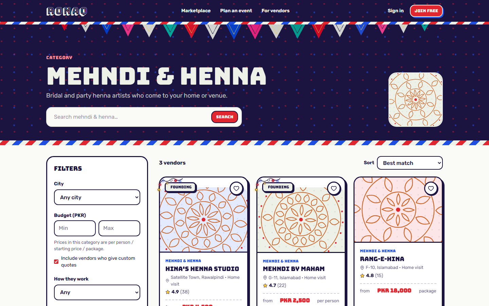 | 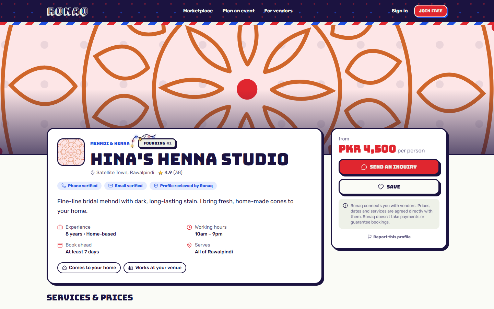 |
| **Category page:** filters defined by attributes | **Vendor profile:** founding badge, verification, honest prices |
| 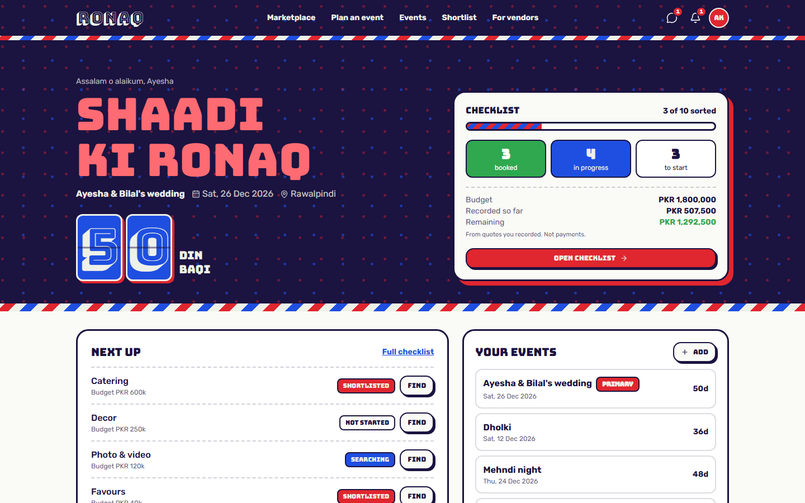 | 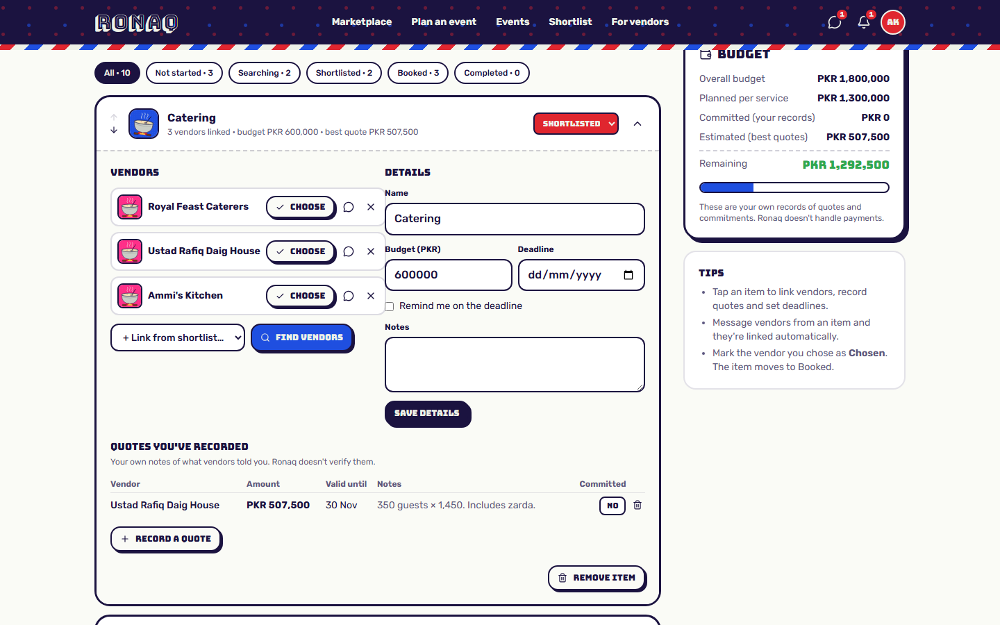 |
| **Dashboard:** event heading, PKT countdown, budget | **Checklist:** linked vendors, quotes, deadlines |
| 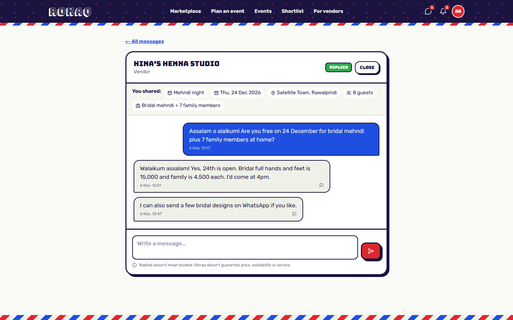 | 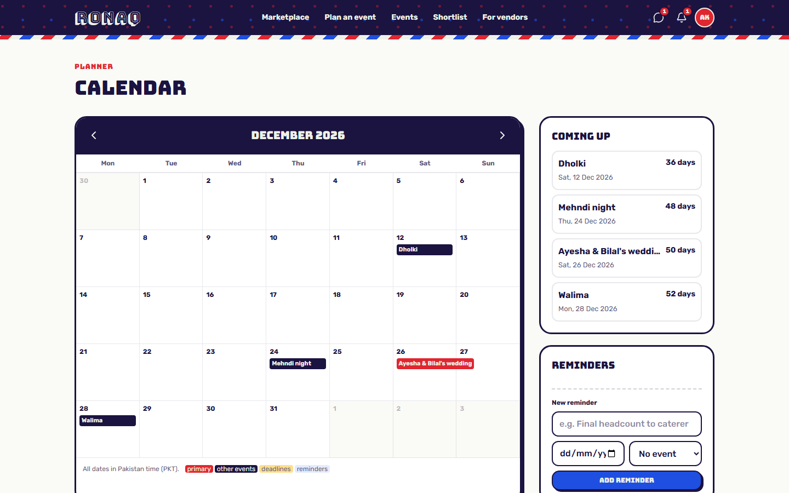 |
| **Inquiries:** only the details the family chose to share | **Calendar:** events, deadlines, reminders |
| 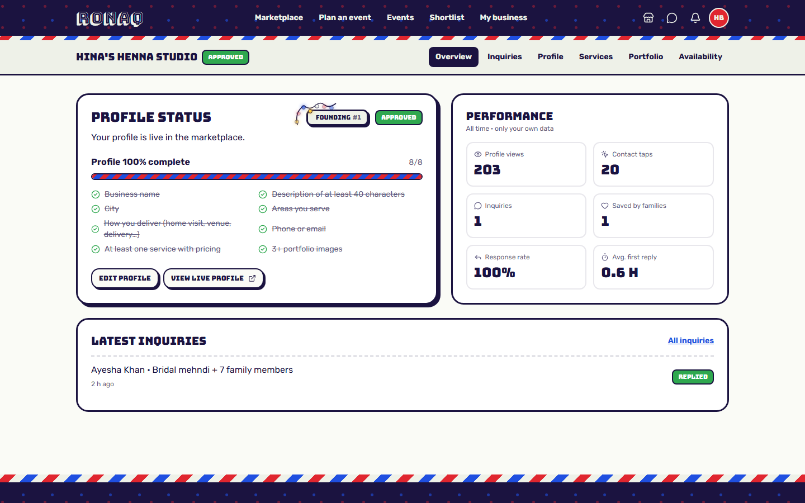 | 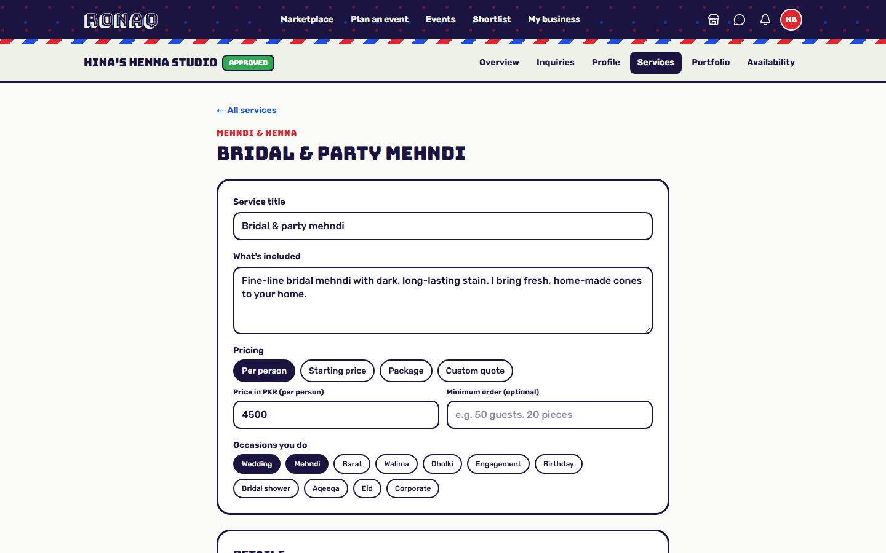 |
| **Vendor dashboard:** completeness and own metrics | **Service form:** questions driven by the category |
| 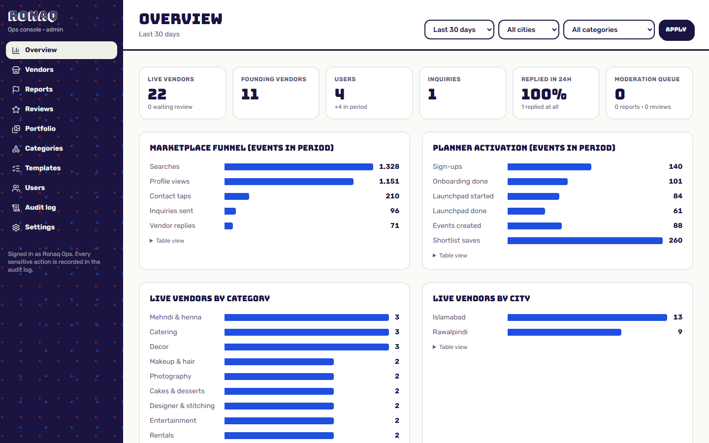 | 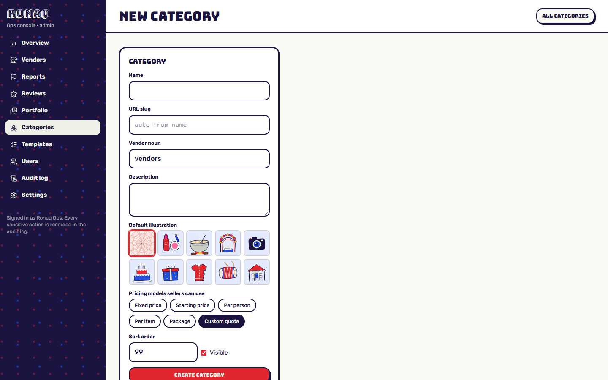 |
| **Ops console:** funnel and supply analytics | **Attribute editor:** new filters with no release |

<p align="center">
  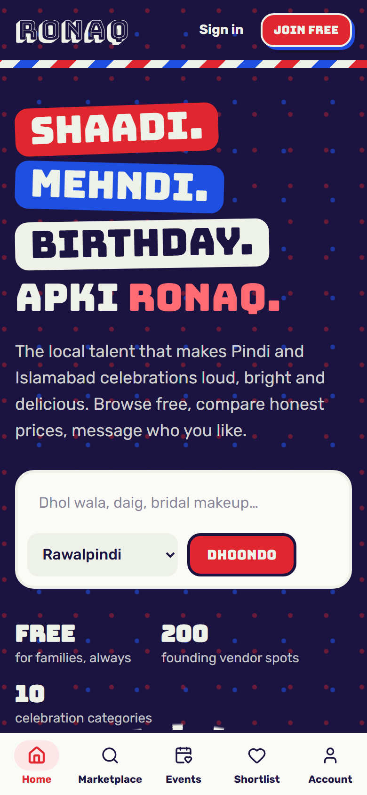
  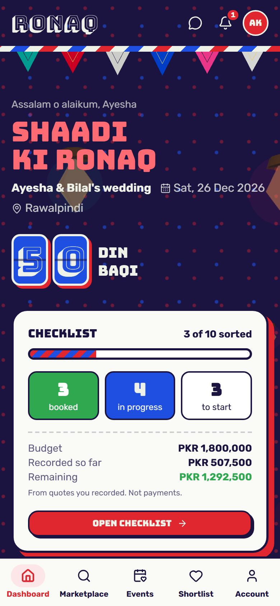
  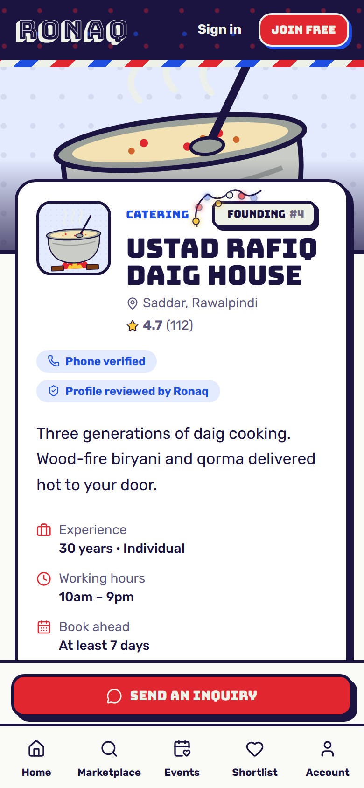
</p>
<p align="center"><b>Mobile first:</b> bottom tab bar, sticky contact button, touch-friendly controls</p>

## Design

The visual identity comes from **Pakistani truck art**: sticker-style headings set in Bungee, reflective tape stripes as dividers, bunting, and a palette of deep indigo, truck blue and red with a soft sage beige.

- **Interactive 3D (react-three-fiber).** In the hero you can drag a model that changes from a henna mandala to a beating dhol to a birthday cake with flickering candles. There's also waving 3D bunting, a market stall you can spin, a gift box that bursts open, and floating lanterns.
- **Procedural illustrations.** Every vendor without photos gets an SVG illustration of their craft (daig on a wood fire, camera, cake, mandala), generated from a seed so no two look alike.
- **Accessible motion.** All 3D loads lazily, falls back to SVG without WebGL, and respects `prefers-reduced-motion`.

## Tech stack

| Layer | Choice |
|---|---|
| Framework | **Next.js 15** (App Router, React Server Components, Server Actions), **React 19**, **TypeScript** (strict) |
| Styling | **Tailwind CSS 4** with design tokens |
| 3D and motion | **three.js**, **@react-three/fiber**, **@react-three/drei**, canvas confetti |
| Data | **Drizzle ORM** on **libSQL / SQLite**, with **Turso** in production |
| Auth | Built in-house: bcrypt password hashes, signed JWT session cookies (`jose`), role-based access |
| Storage | **Vercel Blob** for uploads, checking each file's real type before saving |
| Validation | **Zod** |
| Testing | **Vitest** unit tests for the business rules, plus Playwright end-to-end checks of the main flows |
| Hosting | **Vercel**, entirely on free tiers |

## Architecture

```
src/
  app/
    (site)/            family site, planner and vendor dashboard
    (admin)/admin/     operations console (its own layout and role checks)
    actions/           server actions: auth, market, inquiries, planner, seller, reviews, admin
  components/
    three/             3D scenes, lazy-loaded with SVG fallbacks
    art/               procedural truck-art craft illustrations
    market/ vendor/ planner/ inbox/ admin/ ui/
  db/
    schema.ts          20 tables: users, vendors, services, attributes, events, checklist,
                       inquiries, messages, reviews, reports, audit log, analytics…
    catalog.ts         launch categories, attributes, cities and areas, event templates
  lib/
    domain.ts          business rules as pure functions (unit-tested)
    search.ts          server-side search, filters, service areas, sorting
    time.ts            Pakistan-time calendar maths
    auth.ts, ratelimit.ts, storage.ts, track.ts, settings.ts
```

**Decisions worth noting:**
- **Mutations are server actions.** Every one checks ownership on the server (a checklist item must belong to an event the user owns), and thread access is decided in a server-only module, never in a callable action.
- **The catalogue is data, not code.** Categories, attributes, price models and templates live in the database, so ops can add "Dhol players: number of drummers" as a filter without a release.
- **Privacy by default.** Analytics store pseudonymous IDs and never include message text or private event details. Contact details are shared only when the owner opts in.
- **Dates use Pakistan time.** Countdown and calendar maths use Asia/Karachi, tested around the late-night UTC/PKT date rollover.
- **Location matching.** A vendor matches an area if they serve the whole city, list that area, or are within their service radius (haversine distance).
- **Rate limits** on sign-in, sign-up, reports, inquiries and messages. Security headers are set globally.

## Run it locally

```bash
git clone https://github.com/moiz-1995/ronaq.git && cd ronaq
npm install
npm run db:migrate && npm run db:seed   # SQLite file + demo data
npm run dev                              # http://localhost:3000
```

Local demo logins: `ayesha@example.com` and `hina@example.com` with password `password123`, and `admin@ronaq.pk` / `ronaq-admin`.

```bash
npm test          # business-rule unit tests
npm run typecheck
npm run lint
npm run build
```

### Deploying

1. Create a Vercel project.
2. Add the **Turso** integration, which injects `TURSO_DATABASE_URL` and `TURSO_AUTH_TOKEN`.
3. Add a **Blob** store, which injects `BLOB_READ_WRITE_TOKEN`.
4. Set `AUTH_SECRET`.
5. Run migrations and seed with `SEED_ADMIN_PASSWORD` and `SEED_MOD_PASSWORD` set.

## Roadmap

Android app · phone OTP sign-in · Urdu with right-to-left layout · push and email notifications · more cities. See [TODO.md](TODO.md).

---

<div align="center">
Built by <a href="https://github.com/moiz-1995">Agha Moiz</a> · Rawalpindi / Islamabad
</div>
